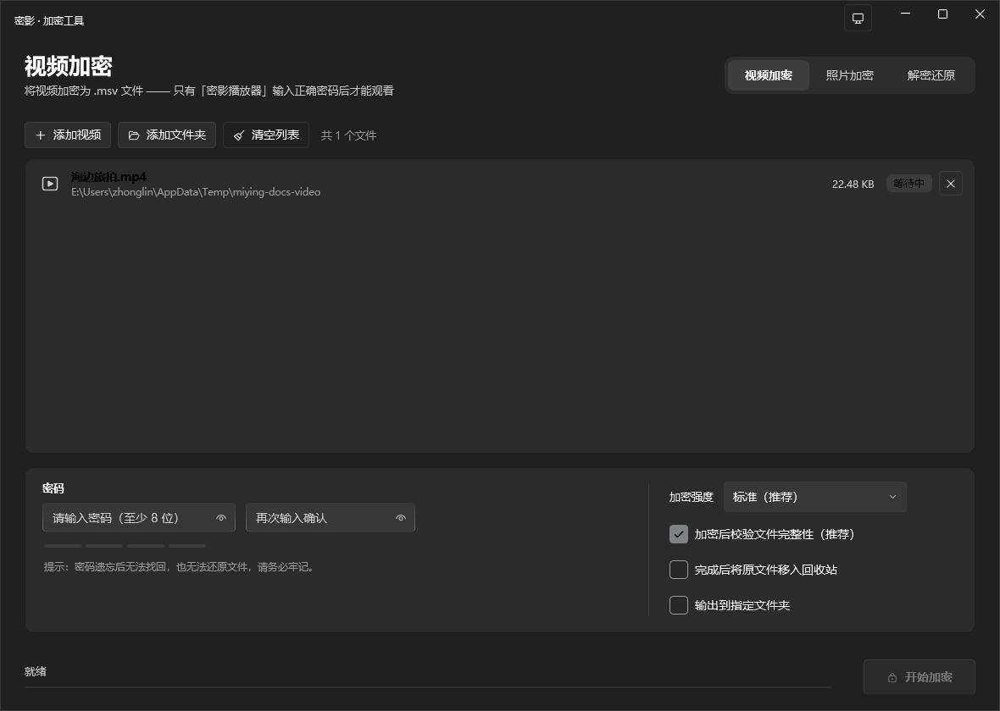
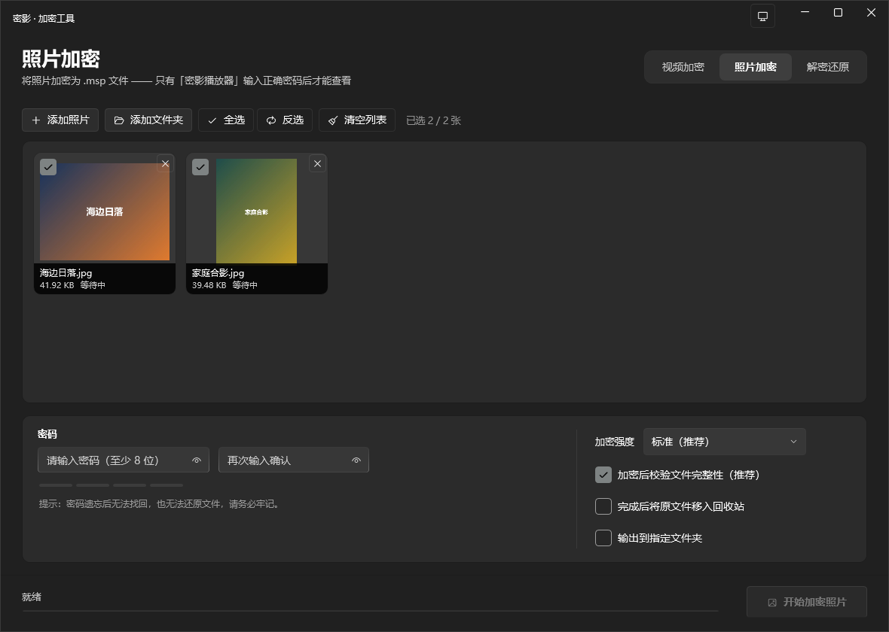
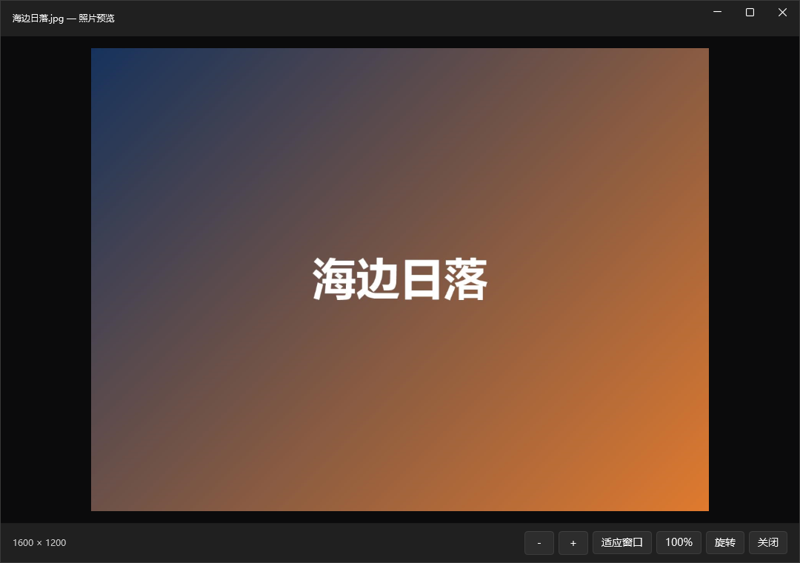
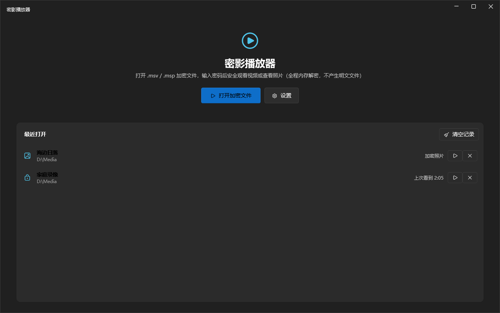
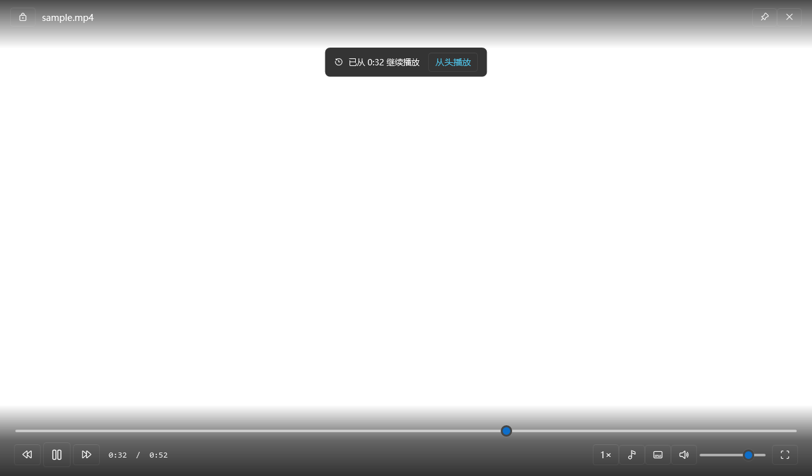
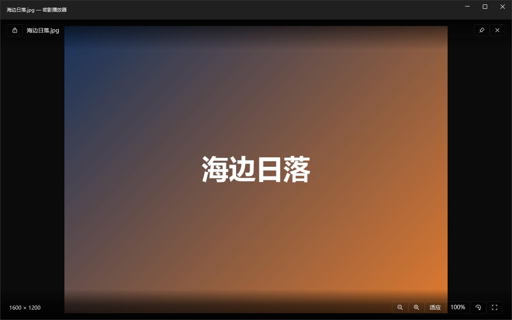

# 密影（MiYing）· 视频 / 照片加密套件

基于 **C# + WPF (.NET 9)** 打造的一对桌面工具：把自己的私人视频和照片加密成只有专用查看器才能打开的格式，界面采用 Win11 Fluent 风格。

| 工具 | 说明 |
| --- | --- |
| **密影 · 视频 / 照片加密工具**（MiYing.Encryptor） | 把 MP4 等视频批量加密为 `.msv`、把照片加密为 `.msp`；也支持解密还原 |
| **密影 · 加密媒体查看器**（MiYing.Player） | 输入密码后**内存直通**播放 `.msv` / 查看 `.msp`，全程不产生明文文件 |













## 功能特性

### ① 视频 / 照片加密工具
- 拖拽 / 批量添加文件或整个文件夹；自动过滤、去重
- 视频加密为 `.msv`，照片加密为 `.msp`（同一加密容器，不同扩展名）
- 照片模式：缩略图网格、勾选 / 全选 / 反选、双击大图预览（缩放 / 拖动 / 旋转）
- 照片按扩展名识别；扩展名未知时按解密后的文件签名识别，避免误入视频播放界面
- 自动纠正手机照片的 EXIF 方向
- 视频加密 / 照片加密 / 解密还原三种模式，一键切换
- 密码强度实时评估；弱密码二次确认；两次输入一致性校验
- 加密强度可选：标准（PBKDF2 60 万次迭代）/ 增强（120 万次）
- 加密后完整性校验（可选，默认开启）；检查每个数据块认证标签
- 完成后可把原文件**移入回收站**（可还原，不直接删除）
- 输出位置可选：与原文件同目录 / 指定文件夹；自动避免重名覆盖
- 逐文件进度、阶段提示（派生密钥 / 加密 / 校验）、失败原因定位、随时取消
- 原子写入：先写 `.part` 临时文件再改名，取消或失败不会留下半成品
- 浅色 / 深色 / 跟随系统主题

### ② 加密媒体查看器
- 打开 `.msv` / `.msp` → 输入密码 → 播放视频或查看照片；支持多选文件加入「本次列表」、缩略图卡片、双击播放 / 查看
- 照片列表支持上一张 / 下一张（← / →），缩略图在后台懒加载，切换照片无需反复返回列表
- 支持拖拽、最近打开列表、双击/回车解锁
- 照片查看：滚轮以鼠标为中心缩放、拖动、双击适应 / 100%（按图片像素显示）、`R` 旋转、`F` 全屏
- 照片查看默认禁用复制（`Ctrl+C`、`Ctrl+Insert`、右键菜单），避免一键导出明文
- 显示照片尺寸、拍摄时间、相机型号（有 EXIF 时）
- **内存直通播放**：AES-GCM 分块按需解密，解密数据只存在于内存并直接交给 VLC 解码，磁盘上任何时候都不存在明文
- 视频播放记录与进度记忆（可关闭）；再次打开自动**从上次位置继续播放**，并提供「从头播放」
- 完整播放控制：进度拖动、倍速（0.5×~3×）、音量/静音、窗口置顶、全屏
- 音轨切换、字幕轨道切换、加载外置字幕（srt/ass/ssa/vtt/sub）
- 视频快捷键：`空格/K` 播放暂停、`←/→` ±5 秒（Shift ±30 秒）、`↑/↓` 音量、`M` 静音、`F/F11` 全屏、`Esc` 退出全屏、`O` 打开文件
- 照片快捷键：`←/→` 上一张/下一张、`0` 适应窗口、`1` 100%、`R` 旋转、`+/-` 缩放、`F/F11` 全屏、`Esc` 退出全屏、`O` 打开文件
- 空闲 3 秒自动隐藏控制栏，鼠标移动即显示；视频画面单击播放/暂停、双击全屏，照片画面双击适应 / 100%、拖动平移
- 锁定按钮：一键停止播放 / 查看并隐藏画面（配合「记住密码（仅本次运行）」可快速解锁）
- 密码与密钥不落盘；进程退出后全部失效

## 安全设计

### MSV / MSP 文件格式 v1（同一容器）
| 偏移 | 长度 | 字段 |
| --- | --- | --- |
| 0 | 4 | 魔数 `MSV1` |
| 4 | 1 | 格式版本 |
| 5 | 1 | KDF 标识（1 = PBKDF2-HMAC-SHA256） |
| 6 | 1 | 加密算法标识（1 = AES-256-GCM） |
| 7 | 1 | 标志位（保留） |
| 8 | 4 | KDF 迭代次数 |
| 12 | 16 | 盐值（每文件随机） |
| 28 | 4 | 分块大小（明文，默认 1 MiB） |
| 32 | 8 | 明文总长度 |
| 40 | 8 | 基础 Nonce（每文件随机） |
| 48 | 2 | 原始文件名长度 |
| 50 | N | 原始文件名（UTF-8，解密还原时恢复文件名） |

> 视频使用 `.msv`，照片使用 `.msp`。两者容器完全相同，媒体类型由文件头中保存的原始文件名扩展名判断；旧 `.msv` 文件完全兼容。

其后为密文区：每个数据块 = `密文 + 16 字节 GCM 认证标签`，块 Nonce = 基础 Nonce(8B) + 块序号(4B)。

### 加密方案
- **AES-256-GCM 分块认证加密**：每 1 MiB 一块，块内数据无法被篡改而不可察觉；文件被截断、追加、翻转任何一字节都会导致对应块校验失败
- **文件头整体作为 AAD**：修改迭代次数、盐值、块大小等任何头部字段都会立刻导致认证失败
- **PBKDF2-HMAC-SHA256 密钥派生**：每个文件独立 16 字节随机盐，标准 60 万次 / 增强 120 万次迭代，明显抬高离线暴力破解成本
- **照片与视频共用同一套加密流程**：AES-256-GCM 分块 + PBKDF2，照片不会被降级处理
- **每文件独立随机 Nonce**：同一密码加密的所有文件之间不存在 Nonce 复用
- **原子写入**：临时文件 + 原子改名，取消/断电不产生半成品
- 随机数全部来自操作系统 CSPRNG（`RandomNumberGenerator`）

### 威胁模型（请务必了解）
**能防：** 文件被拷贝、网盘泄露、丢失硬盘后，没有密码 + 专有查看器无法观看；照片无法通过 `Ctrl+C` / 右键菜单直接复制出明文；任何篡改都能被检测。
**不能防：** 弱密码被 GPU 暴力破解（**请使用 12 位以上、混合大小写+数字+符号的强密码**）；当前已登录系统的恶意程序从内存读取；对着屏幕拍照、自行截屏或录屏（本版本仅禁复制，不防截屏）。
**元数据提示：** 加密文件头中保存了原始文件名与大小（用于还原），文件名本身是可见的；如不想暴露，可在加密后重命名 `.msv` / `.msp` 文件。

## 快速开始

### 使用发布版
1. 运行 `publish.ps1`（或在 VS 中发布）后得到 `dist\` 目录，**绿色免安装、自带 .NET 运行时**；
2. 打开 `dist\MiYing.Encryptor\MiYing.Encryptor.exe`：加密视频时把视频拖进去；加密照片时切换到「照片加密」，拖入照片或整个文件夹，勾选要加密的照片；
3. 打开 `dist\MiYing.Player\MiYing.Player.exe`，把生成的 `.msv` / `.msp` 拖进去，输入密码即可观看或查看；
4. 需要还原时，在加密工具切换到「解密还原」模式即可（原始视频 / 照片文件名会自动恢复）。

### 使用单文件版（双击即用）
`dist\single\` 下是两个**独立单文件 exe**，拷贝、发送、改名、换位置都可以，双击直接用：

| 文件 | 大小 | 说明 |
| --- | --- | --- |
| `MiYing.Encryptor.exe` | 约 65 MB | 视频 / 照片加密工具 |
| `MiYing.Player.exe` | 约 209 MB | 加密媒体查看器（内置 VLC 内核） |

> 首次双击会自动把运行环境解压到系统临时目录（播放器约需几秒，之后每次启动秒开）；功能与文件夹版完全一致。

### 从源码构建
环境要求：Windows 10/11 + .NET 9 SDK。

```powershell
.\build.ps1     # 构建 + 运行单元测试
.\publish.ps1   # 发布免安装版到 dist\
```

> 注意：本机 SDK 缺少部分 Workload 解析器目录，解决方案级**并行**构建会静默失败，
> 因此脚本统一使用 `-m:1 -nr:false`（单节点、禁用节点复用）。命令行手动构建时请带上这两个参数。

### 命令行模式（自动化 / 脚本调用）
```powershell
# 加密 / 解密（退出码 0 表示成功，日志写入 %TEMP%\miying-cli.log）
MiYing.Encryptor.exe --encrypt <输入文件> <输出文件> <密码>
MiYing.Encryptor.exe --decrypt <输入文件> <输出文件> <密码>
```

## 项目结构
```
MiYingVideo.sln
├─ src\MiYing.Core            加解密内核（MSV 格式 / AES-GCM / PBKDF2 / 按需解密流）
├─ src\MiYing.UI              共享照片预览控件（缩放 / 拖动 / 旋转 / 禁复制）
├─ src\MiYing.Encryptor       ① 视频 / 照片加密工具（WPF + WPF-UI）
├─ src\MiYing.Player          ② 加密媒体查看器（WPF + WPF-UI + LibVLC）
├─ tests\MiYing.Core.Tests    75 个单元测试（视频/照片往返、篡改、截断、随机定位、取消、命名等）
├─ dist\                      发布产物（文件夹版 + single\ 单文件版）
├─ qa\                        本地自测样例（可选，不随仓库分发）
├─ build.ps1 / publish.ps1
```

## 测试与验收
- 75 个单元测试全部通过：视频/照片加解密往返（含 0 字节 / 跨块边界）、错误密码、篡改检测、截断检测、尾部追加检测、头部篡改检测、随机定位读取、流式读取、进度回调、取消清理、命名规则；
- 端到端自检（`--selftest`，结果写入 `%TEMP%\miying-selftest.log`）：视频验证自动解锁 → 播放进度推进 → 跳转 → 自动续播；照片验证自动解锁 → 解密流解码 → 尺寸与截图；
- 照片端到端验证：加密为 `.msp` → 从解密流直接解码 → 缩略图生成 → EXIF 方向纠正 → 解密还原，全部通过。

## 常见问题
- **忘记密码怎么办？** 无法恢复。密码是唯一凭证，这是加密工具的设计要求，请务必牢记并妥善备份。
- **加密后能在别的电脑观看吗？** 可以。任何电脑安装本查看器（或拷贝 `dist\MiYing.Player` 文件夹）后输入密码即可。
- **支持哪些媒体格式？** 视频加密侧支持 mp4 / mov / mkv / avi / webm / m4v / ts / flv / wmv / mpg / 3gp / rmvb，播放侧由内置 VLC 内核解码，H.264 / H.265(HEVC) / AV1 等常见编码均可播放；照片加密侧支持 jpg / jpeg / jpe / jfif / png / bmp / gif / tif / tiff / ico / webp / heic / heif / avif，查看侧由 WPF 原生解码。HEIC / AVIF / WebP 依赖系统已安装的对应解码器；未安装时会提示无法解码，而不会进入视频播放界面。
- **为什么单文件版比较大（约 65MB / 209MB）？** 两个单文件都自带 .NET 运行时；播放器还内置了 VLC 解码内核（H.264/H.265/AV1 全格式，免装解码器）。文件已经过压缩，首次启动会自动解压（约几秒），之后秒开。
- **杀毒软件报警？** 加密工具会大量读写文件并做加密运算，个别启发式引擎可能提示，属正常现象，可加入信任目录。

- **双击后看不到窗口（任务栏有图标）？** 一般是窗口被"最小化/隐藏"方式启动所致：程序启动时会自动恢复正常显示并置前，直接再双击一次即可。如个别显卡/驱动环境下窗口仍不显示，可设置环境变量 `MIYING_SOFTWARE_RENDER=1` 后重试（强制软件渲染模式）。
- **Windows 10 上的界面说明：** Mica 背景材质仅 Windows 11 支持，程序在 Windows 10 上会自动改用不透明背景（避免个别驱动下窗口不可见），不影响任何功能。

## 许可与第三方组件
- [LibVLC / VideoLAN](https://www.videolan.org/) — LGPL-2.1（通过 NuGet 动态链接使用；分发时请随附其许可声明）
- [LibVLCSharp](https://code.videolan.org/videolan/LibVLCSharp) — LGPL-2.1
- [WPF-UI (lepo.co)](https://github.com/lepoco/wpfui) — MIT
- [CommunityToolkit.Mvvm](https://github.com/CommunityToolkit/dotnet) — MIT

> 仓库不包含 `qa` 下的视频 / 照片二进制样例；可先用加密工具自行生成 `.msv` / `.msp` 进行验证。